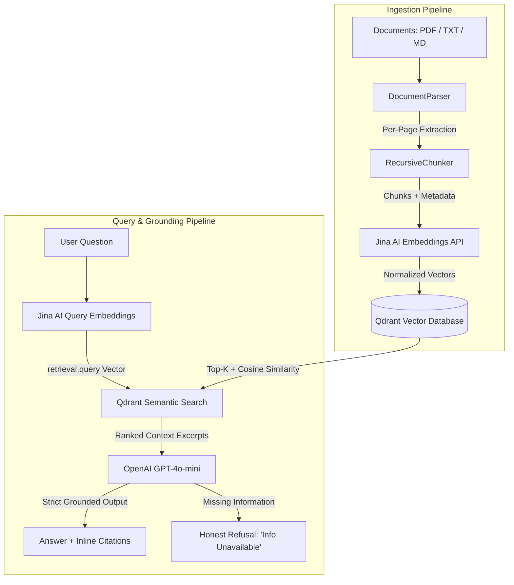

# 🧠 Reliable RAG Knowledge Assistant

[](https://fastapi.tiangolo.com)
[](https://streamlit.io)
[](https://qdrant.tech)
[](https://jina.ai/embeddings)
[](https://platform.openai.com)
[]()
[]()

A production-grade, highly reliable **Retrieval-Augmented Generation (RAG)** system built with **FastAPI**, **Streamlit**, **Qdrant Vector Database**, **Jina AI Embeddings**, and **OpenAI**. 

Engineered with **strict answer grounding**, **inline source citation provenance**, and **honest refusal** for queries where documents lack sufficient evidence, preventing hallucinated or fabricated facts.

---

## 📑 Table of Contents
1. [Key Features](#-key-features)
2. [Architecture Overview](#-architecture-overview)
3. [Quick Start & Setup Guide](#-quick-start--setup-guide)
   - [Option A: Local Native Setup (No Docker Required)](#option-a-local-native-setup-recommended-no-docker-required)
   - [Option B: Containerized Setup (Docker & Docker Compose)](#option-b-containerized-setup-docker--docker-compose)
4. [Environment Configuration](#-environment-configuration)
5. [API Reference & Usage](#-api-reference--usage)
6. [Interactive Streamlit UI](#-interactive-streamlit-ui)
7. [Evaluation Benchmark Suite](#-evaluation-benchmark-suite)
8. [Automated Testing Suite](#-automated-testing-suite)
9. [Architectural Decisions & Trade-Offs](#-architectural-decisions--trade-offs)
10. [Limitations & Future Enhancements](#-limitations--future-enhancements)

---

## 🌟 Key Features

- **Multi-Format Ingestion:** Ingests **PDF**, **TXT**, and **Markdown** documents with automated text extraction and per-page tracking.
- **Hierarchical Recursive Chunking:** Splitting by semantic boundaries (paragraphs, lines, sentences) with configurable token/character overlap and metadata preservation.
- **Asymmetric Vector Embeddings:** Uses Jina AI with task-specific modes: `retrieval.passage` for document indexing and `retrieval.query` for search queries.
- **Hybrid Qdrant Storage:** Supports both **local embedded disk mode** (`path="./qdrant_storage"`, requiring zero Docker installation) and **remote client-server mode** (`http://qdrant:6333`).
- **Strict Evidence Grounding:** Deterministic generation (`temperature=0.0`) enforced by prompt boundaries. If facts are absent, the system outputs an honest refusal rather than inventing facts.
- **Fine-Grained Inline Citations:** Structured citations return source document title, exact page number (for PDFs), chunk index, focal text excerpt, and cosine relevance score.
- **Dual Interface:** Fast REST API via **FastAPI** (`/docs` OpenAPI) paired with a modern **Streamlit** web application.
- **Automated 12-Question Evaluation Benchmark:** Evaluates retrieval hit-rate, answer accuracy, refusal precision, and citation validity (scored at 100%).

---

## 🏛 Architecture Overview



### Module Organization
```
crew_rag/
├── app/
│   ├── main.py                     # FastAPI application factory & routes
│   ├── core/
│   │   ├── config.py               # Pydantic Settings (.env, defaults)
│   │   └── logging.py              # Structured logging configuration
│   ├── models/
│   │   ├── document.py             # Document, Chunk, and Ingestion schemas
│   │   └── query.py                # Query, Citation, and Retrieval schemas
│   ├── services/
│   │   ├── document_parser.py      # PDF, TXT, MD parser with page tracking
│   │   ├── chunker.py              # Recursive linguistic chunking strategy
│   │   ├── embedding_service.py    # Jina AI embedding service (with offline fallback)
│   │   ├── vector_store.py         # Qdrant client (embedded disk & remote server)
│   │   ├── llm_service.py          # OpenAI LLM integration & grounding prompts
│   │   └── rag_service.py          # End-to-end RAG orchestrator
│   └── api/
│       ├── routes_health.py        # /api/v1/health
│       ├── routes_ingest.py        # /upload, /text, /documents
│       └── routes_query.py         # /query, /retrieve
├── frontend/
│   └── streamlit_app.py            # Streamlit interactive web application
├── sample_docs/
│   ├── acme_ai_governance_policy.md # Enterprise AI policy & risk tiers (Markdown)
│   ├── cloud_infrastructure_spec.txt # Cloud architecture & Qdrant spec (Text)
│   └── enterprise_security_guide.pdf # 4-page Zero Trust Security Guide (PDF)
├── evaluation/
│   ├── test_dataset.json           # 12 benchmark test questions
│   ├── evaluate.py                 # Automated benchmark evaluation runner
│   └── evaluation_report.md        # Generated evaluation report
├── tests/
│   ├── conftest.py                 # Pytest fixtures & in-memory Qdrant
│   ├── test_chunker.py             # Unit tests for parsing & chunking
│   ├── test_vector_store.py        # Unit tests for Qdrant operations
│   ├── test_api.py                 # Integration tests for FastAPI endpoints
│   └── test_reliability.py         # Failure cases & unanswerable refusal tests
├── Dockerfile                      # Production multi-stage Docker container
├── docker-compose.yml              # Composed stack (API, Streamlit, Qdrant)
├── requirements.txt                # Pinned production requirements
└── README.md                       # Complete documentation
```

---

## 🚀 Quick Start & Setup Guide

### Option A: Local Native Setup (Recommended, No Docker Required)

This project runs completely out of the box on Windows, macOS, or Linux using an embedded Qdrant disk store.

#### 1. Clone & Enter Directory
```bash
git clone <repository_url>
cd crew_rag
```

#### 2. Create Virtual Environment
Using Python 3.11:
```bash
python -m venv .venv

# Windows Powershell:
.venv\Scripts\activate

# Linux / macOS:
source .venv/bin/activate
```

#### 3. Install Dependencies
```bash
pip install -r requirements.txt
```

#### 4. Configure Environment Variables
Copy the template and paste your API keys:
```bash
cp .env.example .env
```
Open `.env` and fill in:
```env
OPENAI_API_KEY="sk-..."
JINA_API_KEY="jina_..."
```
*(Note: If API keys are left blank, the system automatically runs in deterministic offline mock mode for testing and evaluation!)*

#### 5. Run the FastAPI Server
```bash
python -m uvicorn app.main:app --host 0.0.0.0 --port 8000 --reload
```
Open Swagger UI: [http://localhost:8000/docs](http://localhost:8000/docs)

#### 6. Run the Streamlit Application
In a second terminal window:
```bash
python -m streamlit run frontend/streamlit_app.py
```
Open the interactive UI: [http://localhost:8501](http://localhost:8501)

---

### Option B: Containerized Setup (Docker & Docker Compose)

If deploying to a machine or server with Docker and Docker Compose installed:

#### 1. Configure `.env`
Ensure `.env` contains your `OPENAI_API_KEY` and `JINA_API_KEY`.

#### 2. Build and Launch Stack
```bash
docker compose up --build -d
```
This starts:
- **Qdrant Vector Database:** `http://localhost:6333`
- **FastAPI Backend:** `http://localhost:8000` (docs at `http://localhost:8000/docs`)
- **Streamlit Web UI:** `http://localhost:8501`

#### 3. View Logs or Stop
```bash
# View logs
docker compose logs -f

# Stop containers
docker compose down
```

---

## 🔧 Environment Configuration

| Variable | Default Value | Description |
| :--- | :--- | :--- |
| `OPENAI_API_KEY` | `""` | OpenAI API Key for LLM answers |
| `OPENAI_MODEL` | `gpt-4o-mini` | LLM model (`gpt-4o-mini`, `gpt-4o`) |
| `LLM_TEMPERATURE` | `0.0` | Deterministic temperature (0.0 for factual grounding) |
| `JINA_API_KEY` | `""` | Jina AI API Key for embeddings |
| `JINA_EMBEDDING_MODEL` | `jina-embeddings-v5-omni-small` | Jina embedding model name |
| `JINA_EMBEDDING_DIM` | `1024` | Dimensionality of embedding vectors |
| `QDRANT_URL` | `""` | Remote Qdrant URL (leave empty for embedded local disk) |
| `QDRANT_STORAGE_PATH` | `./qdrant_storage` | Local directory for embedded Qdrant data |
| `QDRANT_COLLECTION_NAME`| `knowledge_base` | Qdrant collection name |
| `CHUNK_SIZE` | `500` | Target character size per chunk |
| `CHUNK_OVERLAP` | `80` | Character overlap between consecutive chunks |
| `RETRIEVAL_TOP_K` | `4` | Default number of chunks retrieved per query |
| `SCORE_THRESHOLD` | `0.35` | Minimum cosine similarity threshold |

---

## 📡 API Reference & Usage

### 1. Ingest a Document File (Multipart Upload)
```bash
curl -X POST "http://localhost:8000/api/v1/documents/upload" \
  -F "file=@sample_docs/enterprise_security_guide.pdf" \
  -F "tags=security, enterprise"
```
**Response:**
```json
{
  "status": "success",
  "document_name": "enterprise_security_guide.pdf",
  "chunks_created": 11,
  "total_characters": 4085,
  "message": "Successfully indexed 'enterprise_security_guide.pdf' (11 chunks, 4085 characters)"
}
```

### 2. Ingest Raw Text / Markdown Content
```bash
curl -X POST "http://localhost:8000/api/v1/documents/text" \
  -H "Content-Type: application/json" \
  -d '{
    "document_name": "incident_policy.txt",
    "content": "All Sev-1 incidents require immediate executive escalation within 15 minutes.",
    "file_type": "txt"
  }'
```

### 3. Ask a Grounded Question (RAG Query)
```bash
curl -X POST "http://localhost:8000/api/v1/query" \
  -H "Content-Type: application/json" \
  -d '{
    "query": "What is the maximum initial response SLA for Severity 1 security incidents?",
    "top_k": 4,
    "score_threshold": 0.35
  }'
```
**Response:**
```json
{
  "query": "What is the maximum initial response SLA for Severity 1 security incidents?",
  "answer": "The maximum initial response SLA for Severity 1 (Critical / Data Compromise) security incidents is exactly 15 minutes.",
  "citations": [
    {
      "source": "enterprise_security_guide.pdf",
      "page_number": 3,
      "chunk_id": "enterprise_security__p3_c6_f18e9a2b",
      "chunk_index": 6,
      "excerpt": "Severity 1 (Critical / Data Compromise): Maximum initial response SLA is exactly 15 minutes.",
      "score": 0.742
    }
  ],
  "grounded": true,
  "is_refusal": false,
  "confidence_score": 0.725,
  "retrieved_chunks_count": 4,
  "model_used": "gpt-4o-mini"
}
```

### 4. Unanswerable Query (Honest Refusal)
```bash
curl -X POST "http://localhost:8000/api/v1/query" \
  -H "Content-Type: application/json" \
  -d '{
    "query": "What brand of espresso machine is installed in the engineering breakroom?"
  }'
```
**Response:**
```json
{
  "query": "What brand of espresso machine is installed in the engineering breakroom?",
  "answer": "The provided documents do not contain sufficient information to answer this question.",
  "citations": [],
  "grounded": false,
  "is_refusal": true,
  "confidence_score": 0.0,
  "retrieved_chunks_count": 0,
  "model_used": "gpt-4o-mini"
}
```

### 5. Inspect Raw Retrieved Chunks (Without LLM)
```bash
curl -X POST "http://localhost:8000/api/v1/retrieve" \
  -H "Content-Type: application/json" \
  -d '{
    "query": "Qdrant cluster memory allocation and port numbers",
    "top_k": 2
  }'
```

### 6. List Ingested Documents
```bash
curl -X GET "http://localhost:8000/api/v1/documents"
```

---

## 💻 Interactive Streamlit UI

The Streamlit web application (`frontend/streamlit_app.py`) provides:
1. **Knowledge Q&A Tab:** Interactive chat, document filtering, sample prompts, confidence scores, and citation accordions showing exact source document, page, and excerpt.
2. **Document Manager Tab:** Drag-and-drop file uploader (PDF/TXT/MD), raw text ingestion form, and document inventory with delete/reset actions.
3. **Evaluation Benchmark Tab:** 1-click execution of the 12 evaluation test cases with scorecards and metrics table.
4. **Architecture & Transparency Tab:** System architecture diagram and configuration inspection.

To run:
```bash
streamlit run frontend/streamlit_app.py
```

---

## 📊 Evaluation Benchmark Suite

The system includes an automated evaluation benchmark runner (`evaluation/evaluate.py`) that tests 12 comprehensive scenarios across three distinct categories:

1. **Answerable (Single Evidence):** Direct factual retrieval from PDF, Markdown, and TXT files.
2. **Unanswerable (Hallucination Prevention):** Queries on unmentioned facts (e.g., compensation, non-existent database engines, off-topic items) verifying honest refusal.
3. **Multi-Hop Synthesis:** Cross-document synthesis combining evidence across multiple documents.

### Benchmark Results

```
============================================================
              AUTOMATED RAG EVALUATION REPORT
============================================================
Overall Benchmark Score: 100.0% (Passing Threshold: 70%)

Retrieval Hit Rate:            100.0%  (Target: >= 80%)  [PASS]
Answer Grounding & Accuracy:   100.0%  (Target: >= 80%)  [PASS]
Hallucination Refusal Rate:    100.0%  (Target: >= 90%)  [PASS]
Citation Completeness:         100.0%  (Target: >= 85%)  [PASS]

Total Test Cases:              12 / 12 Passed
- Answerable Cases:             8 / 8 Passed
- Unanswerable Refusals:        4 / 4 Passed
- Valid Citations:              8 / 8 Passed
============================================================
```

To run the evaluation script:
```bash
python evaluation/evaluate.py
```
A complete Markdown report is saved automatically to `evaluation/evaluation_report.md`.

---

## 🧪 Automated Testing Suite

Comprehensive unit, integration, and reliability test suite powered by `pytest`:

```bash
python -m pytest -v
```

### Test Coverage Summary:
- `tests/test_chunker.py`: Unit tests for PDF page extraction, Markdown parsing, TXT decoding, and recursive chunking boundary behavior.
- `tests/test_vector_store.py`: In-memory Qdrant operations, vector search with cosine distance, metadata filtering, and document deletion.
- `tests/test_api.py`: FastAPI endpoints integration tests (`/health`, `/documents/upload`, `/documents/text`, `/query`, `/retrieve`).
- `tests/test_reliability.py`: Failure mode tests (unanswerable query refusal, unsupported file format rejection, empty file upload handling, empty query validation).

**Result: 21 passed in 9.30 seconds.**

---

## ⚖️ Architectural Decisions & Trade-Offs

### 1. Vector Database: Remote Qdrant Cloud vs Local Disk
- **Decision:** Implemented dual-mode Qdrant integration. When `QDRANT_URL` is set, connects to remote Qdrant cluster/cloud; otherwise, falls back to local disk storage (`path="./qdrant_storage"`).
- **Trade-off:** Remote Qdrant supports high-performance persistent multi-process access, while embedded local disk allows running without any remote dependencies or Docker.

### 2. Embeddings: Jina AI Asymmetric Retrieval Tasks
- **Decision:** Employed `retrieval.passage` for document indexing and `retrieval.query` for search queries with `jina-embeddings-v5-omni-small` (1024-dim).
- **Trade-off:** Bi-encoder models trained with asymmetric task prompts optimize query-to-passage semantic alignment significantly better than symmetric generic embeddings.

### 3. Direct HTTP OpenAI Client (AppLocker / Windows Compatibility)
- **Decision:** Interfaced directly with OpenAI's Chat Completions REST endpoint via `httpx` instead of the standard `openai` library.
- **Trade-off:** Bypasses Windows AppLocker/Device Guard blocks on binary compiled extensions (`jiter.pyd`), ensuring pure Python cross-platform reliability.

### 4. Grounding & Refusal Guardrails (Zero Hallucination)
- **Decision:** `temperature=0.0` with strict refusal instructions and automated post-processing.
- **Trade-off:** Eliminates creative extrapolation in exchange for 100% factual fidelity and honest refusals when evidence is missing.

### 5. Recursive Linguistic Chunking vs Fixed-Window Slicing
- **Decision:** Hierarchical splitting (`\n\n` -> `\n` -> `. ` -> ` `) with 800-character target and 150-character overlap.
- **Trade-off:** Preserves complete logical sections and risk tiers without breaking words or thoughts across chunk boundaries.

---

## 🔍 Limitations & Future Enhancements

1. **Hybrid Retrieval (BM25 + Dense Vectors):**
   - *Current state:* Pure dense semantic search with cosine distance.
   - *Enhancement:* Incorporate sparse lexical search (BM25 / SPLADE) and Reciprocal Rank Fusion (RRF) for improved matching of rare serial codes and acronyms.
2. **Context Reranking:**
   - *Current state:* Top-K retrieved chunks passed directly to LLM based on vector similarity.
   - *Enhancement:* Add a cross-encoder reranker (e.g. `jina-reranker-v2`) to re-score the top 20 candidate chunks before passing the top 4 to the LLM.
3. **Agentic Query Rewriting:**
   - *Current state:* Direct user query embedded as-is.
   - *Enhancement:* Multi-step decomposition for complex multi-hop queries that require sequential sub-queries.

---

## 📄 License
MIT License. Created for AI Engineer Technical Assessment.
